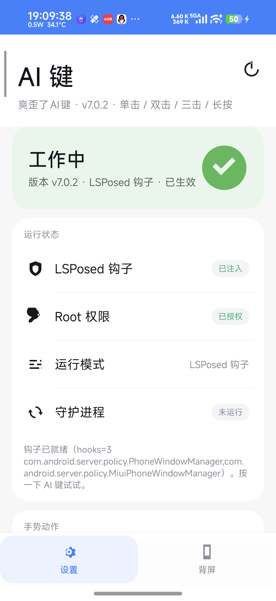
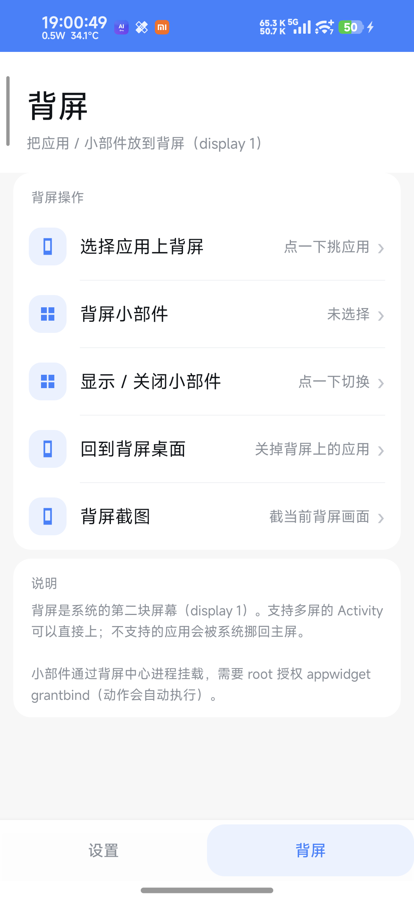

# 爽歪了AI键 · LSPosed 版

把 KernelSU 模块 **aikey_plus v1.1.1** 的按键逻辑做成 LSPosed 模块，并在真机（小米 18 Pro，OS4.0.27）上把动作库扩成一套「AI 键快捷动作中心」。

装 APK → LSPosed 启用（作用域「系统框架」）→ 重启 → 打开 App 授权 root → 选动作。

## 截图

| 设置页 | 背屏页 |
| :---: | :---: |
|  |  |

### 默认手势

| 手势 | 默认动作 |
| --- | --- |
| 单击 | 手电筒开关 |
| 双击 | 系统录屏 |
| 长按 | 系统截图 |

动作库 **81 个**，分五类，其中「原生」动作直接调用 MIUI 自己的动作分发器，覆盖付款码、乘车码、扫码、防窥、静音、勿扰、小爱记忆、背屏截图等。

---

## 一、真机实测结论（OS4.0.27 / M610BB）

这一版最大的修正：**AI 键自己的动作白名单只有 9 个**。

- 反汇编 `miui-services.jar` 里 `com.android.server.input.shortcut.singlekeyrule.MiAiKeyRule` 的 `triggerFunction`，
  它只认：`launch_ai_memory`、`launch_voice_assistant`、`launch_voice_note`、`zen_mode`、`launch_peep_protection`、
  `mute`、`launch_google_search`、`live_subtitles`、`show_shortcut_toast`。
  把 `click_mi_ai_key` 设成付款码这类值，系统会打日志 `Click function not support` 并回退成 `none`——所以上一版那批 `native:` 付款码动作是空转的。
- 系统真正的万能入口是 **`com.miui.server.input.util.ShortCutActionsUtils#triggerFunction(String, String, Bundle, boolean)`**，
  它的 switch 里有 60+ 个 function：付款码/乘车码/扫码/健康码/Mi Pay/au PAY/Google Pay/防窥/静音/勿扰/小爱记忆/小爱识屏/
  背屏截图/局部截图/护眼模式/性能模式/控制中心/通知中心/最近任务/智能家居/查找设备/录音机/计算器/相机（拍照、录像）……
  **v1.3.0 起，`native:` 动作由 system_server 里的钩子直接调它**，不再依赖设置和注入。

实测可用的直启入口（也在动作库里，作为兜底）：

| 动作 | 入口 | 结果 |
| --- | --- | --- |
| 支付宝付款码 | `alipays://platformapi/startapp?appId=20000056` | `com.alipay.mobile.onsitepay.merge.OnsitepayActivity` ✓ |
| 支付宝扫一扫 | `appId=10000007` | `com.alipay.mobile.scan.as.main.MainCaptureActivity` ✓ |
| 支付宝乘车码 | `appId=200011235` | 支付宝小程序容器（CSGAPushActivity）✓ |
| 微信扫一扫 | `com.tencent.mm/.plugin.scanner.ui.BaseScanUI` / `weixin://dl/scan` | `BaseScanUI` ✓ |
| 小米扫一扫 | `com.xiaomi.scanner/.app.ScanActivity` | ✓ |
| 相机 | `com.android.camera/.Camera` | ✓（`STILL_IMAGE_CAMERA` 会弹选择器，别用） |
| 背屏 | `am start --display 1 …` | **display id = 1**，912×596；支付宝付款码可放到背屏 ✓ |
| 小米钱包 | `com.mipay.wallet` | `com.miui.tsmclient` 没有桌面入口，别用 |

**原生动作真机实测（注入 AI 键触发，日志 `手势 -> 原生 xxx ok`）：**

| function | 结果 | 落地界面 |
| --- | --- | --- |
| `launch_alipay_payment_code` | ok | `AlipayGphone/…onsitepay.merge.OnsitepayActivity`（付款码） |
| `launch_wechat_payment_code` | ok | 微信 `UIPageFragmentActivity`（收付款页） |
| `launch_wechat_scanner` / `launch_alipay_scanner` | ok | 扫码界面 |
| `screenshot_rear` | ok | 生成 `Screenshot_…_com.xiaomi.subscreencenter.png`（背屏截图） |
| `launch_peep_protection` | ok | `securitycenter/…antipeeping.v2.ui.PeepProtectionIntroActivity`（防窥） |
| `mute` | ok | —（静音） |
| `launch_voice_assistant` | ok | 超级小爱 |
| `launch_ai_memory` | ok | 小爱记忆 |
| `mi_pay` | ok | `com.miui.tsmclient/.ui.quick.DoubleClickActivity` |
| `show_code_display` | **false** | 需要额外 Bundle，已从动作表移除 |

**45 个原生动作全量实测（注入 AI 键逐个触发）：**

- 通过：唤醒小爱、小爱记忆、小爱记一下、小爱捷径、支付宝/微信付款码、支付宝/微信乘车码、支付宝/微信扫一扫、支付宝健康码、
  Mi Pay、截图、背屏截图、局部截图、手电筒、静音、勿扰、防窥、控制中心、通知中心、智能家居、查找设备、录音机、计算器、
  搜索、桌面、护眼、性能模式、小米创作、菜单、息屏、环境音识别、TalkBack、相机/拍照/录像、实时字幕、全局搜索、语音便签、
  紧急求助、无动画截图、手写笔局部截图、震动、一键清理、分屏左/右、拍立得、听声字幕
- 系统拒绝、已从动作表移除：`launch_recents`、`close_app`、`split_ltr`、`split_rtl`、`hear_sound`、`voice_control`
  （这几个需要额外参数或无障碍权限，直接调返回 false）
- `show_code_display` 需要 Bundle，已移除；背屏付款码改用 `displayScreen=rear`

**背屏小部件（AppWidget）**

背屏那块 display 带 `FLAG_OWN_CONTENT_ONLY`，只有背屏中心自己的窗口能显示。所以做法是：

1. 模块注入 `com.xiaomi.subscreencenter` 进程，注册广播接收器；
2. App 把选中的小部件 provider 广播过去；
3. 背屏中心用 `AppWidgetHost` + `WindowManager.addView(TYPE_APPLICATION_OVERLAY)`
   把 `AppWidgetHostView` 挂到 display 1 上——内容是"它的"，系统放行。

真机日志：

```
AIKey: 背屏小部件接收器已注册
AIKey: 背屏小部件已上屏: ComponentInfo{com.android.browser/...Search4x2Widget} display=1
Window #24 Window{... u0 AIKeyWidget}
```

要求：
- LSPosed 作用域要勾 `com.xiaomi.subscreencenter`（默认已勾）
- root 下执行过 `appwidget grantbind --package com.xiaomi.subscreencenter --user 0`（动作会自动执行）

动作：`背屏：显示小部件` / `背屏：关闭小部件`；在设置页「背屏小部件」里选具体小部件。

**背屏（乐乐背屏同款能力，已内置）**

| 动作 | 实现 | 实测 |
| --- | --- | --- |
| 背屏显示应用… | `am start --display 1 -n 包名/Activity`（选应用时自动解析桌面入口） | ✅ 相机成功开在 Display #1 |
| 背屏：回到背屏桌面 | `am start --display 1 -n com.xiaomi.subscreencenter/.SubScreenLauncher` | ✅ |
| 背屏截图 | `ShortCutActionsUtils` 的 `screenshot_rear` | ✅ 生成 `Screenshot_…_com.xiaomi.subscreencenter.png` |
| 支付宝付款码（系统背屏参数） | `alipays://…&displayScreen=rear` | ✅ `XiaomiQuickpayActivity` on Display #1 |
| 背屏录屏 | `screenrecord --display-id` | ❌ 系统私有屏报 `UNASSIGNED_LAYER_STACK`，已移除 |

微信主界面不支持副屏，`--display 1` 会被系统挪回主屏——这是微信自身限制，不是参数问题（框架里 `launchWeixinPaymentCode`
也没有任何 display 参数）。

另外确认：`com.neko.aikeylsp`（原作者 LSPosed 版）在你机上是**禁用**状态；我们的模块是启用状态，
日志显示已挂钩 `com.android.server.policy.PhoneWindowManager`（2 个方法）和 `com.android.server.policy.MiuiPhoneWindowManager`（1 个方法）。

---

## 二、和原模块的区别

| | 原 KernelSU 模块 | 本应用 |
| --- | --- | --- |
| 安装 | 刷 zip + 重启 | 装 APK + LSPosed 启用 + 重启 |
| 按键识别 | 常驻 `getevent` | system_server 里的 Xposed 钩子（默认），或同一套 `getevent`（备选） |
| 动作 | 11 个 | 62 个，含 MIUI 原生动作与正/背屏 |
| 系统动作 | 无 | 直接调 `ShortCutActionsUtils`，不需要改设置、不需要注入 |

包名仍是 `io.github.jumaoli.aikey`，覆盖安装不丢 LSPosed 启用状态。

---

## 三、安装

1. 装 `dist/aikey-plus-lsp-v1.8.0.apk`。
2. LSPosed → 启用「爽歪了AI键」→ 作用域勾 **系统框架** → **重启**。
3. 打开 App → 允许 root → 选手势动作 → **立即应用**。
4. 按 AI 键。

> **重要**：你这台机器的 root 是 OneKeyJB/hyperbreak 临时注入的，**重启后必须重新注入 root**，否则 LSPosed 不会加载模块、`su` 也不存在。顺序建议：注入 root → 确认 LSPosed 模块列表能看到本模块 → 再重启一次（让 root 在开机时就在），或者注入后让工具完成框架重启。

---

## 四、动作总览（81 个）

### 常用
手电筒开关 / 只开 / 只关 · 系统截图（组合键）· 录屏开关 / 开始 / 停止 · 回到桌面 · 游戏加速 · 相机 / 拍照 / 录像（原生）

### 小爱 / 语音
唤醒超级小爱 · 超级小爱记忆 · 小爱记一下 · 小爱捷径 · 小爱识屏 · 实时字幕 · 全屏实时字幕

### 支付 / 乘车 / 扫码
支付宝付款码 · 微信付款码 · 支付宝乘车码 · 微信乘车码 · 支付宝扫一扫 · 微信扫一扫 · 支付宝健康码 ·
付款码展示（正/背屏）· Mi Pay · 钱包（公交/门卡），
另有直启版：支付宝付款码/乘车码/扫一扫（各带背屏版）、微信扫一扫、小米扫一扫

### 系统功能
截图（原生）· 背屏截图 · 局部截图 · 系统录屏 · 开始/停止录屏（游戏加速）· 手电筒（原生）· 静音 · 勿扰 · 防窥 ·
控制中心 · 通知中心 · 智能家居 · 查找设备 · 录音机 · 计算器 · 搜索 · 最近任务 · 桌面（原生）· 护眼模式 · 性能模式 · 小米创作

### 应用 / 自定义
选择应用… · 自定义命令…（root 执行）

---

## 五、原生动作怎么执行

```
钩子（system_server）
  └─ 手势 → 配置里的动作是 native:xxx ?
        ├─ 是 → ShortCutActionsUtils.getInstance(ctx).triggerFunction("xxx", "click_mi_ai_key", Bundle, false)
        │        · 真机验证：类在 miui-services.jar，方法签名 (String,String,Bundle,Z)Z
        │        · 返回 false 或类不可用 → 回退给 App 的 shell 动作
        └─ 否 → 通过 ContentProvider 交给 App，root shell 执行
```

好处：原生动作 **不需要 root、不需要改设置、不需要注入按键**，直接走 MIUI 自己的分发，正/背屏、区域限制、埋点都和系统原生一致。

兜底：`aikey_lib.sh` 里的 `run_native` 仍然保留（把 `click_mi_ai_key` 设成值 + `sendevent` 注入 AI 键），
但只对上面那 9 个白名单动作有效，用于钩子不可用时的降级。

---

## 五½、Shizuku / Stellar（结论：不能替代 root 激活 AI 键）

> 构建注意：d8 必须用 `--debug`，`--release` 会把 `rikka.shizuku.Shizuku$1` 这类内部类合并掉，
> 导致 Stellar/Shizuku 激活时 `NoClassDefFoundError` 闪退。

本机装了 `moe.shizuku.privileged.api`（Shizuku）和 `roro.stellar.manager`（Stellar，兼容 Shizuku API）。
实测结论：

- 两者给的是 **shell(2000)** 身份；`sendevent /dev/input/event5` 直接被拒
  （`Permission denied`，SELinux），而 AI 键替换必须在内核输入层拦/发；
- 钩子必须注入 `system_server`，只有 LSPosed（需要 root）能做；
- Shizuku API 13.x 的 `newProcess` 是 private，公开接口要用它隐藏的
  `moe.shizuku.server.IShizukuService`（得自己重写 AIDL + Binder 事务），风险高、收益低。

所以本模块保留 **root 必需** 的定位。App 里加了「Shizuku / Stellar」状态行，
显示运行/授权状态并可发起授权，将来若要用它们的普通命令通道（settings / am）可以直接接。


## 五¾、内置乐乐背屏

v1.8.0 起把 `乐乐背屏_0.4.5.apk`（42 MB）打进 assets，背屏页提供：

- **安装 / 更新内置乐乐背屏**：解出到 cache → 复制到 `/data/local/tmp` → `pm install -r -d`（需要 root）
- **打开乐乐背屏**

代价是 APK 从 233 KB 涨到 41.8 MB。源码包里**不含** `assets/lele.apk`（第三方 APK，单独分发）。

## 五¾、界面：底栏两个页签

- **设置**：手势映射、参数、动作表、致谢
- **背屏**：选择应用上背屏 / 背屏小部件 / 显示·关闭小部件 / 回背屏桌面 / 背屏截图 / 打开乐乐背屏

说明：乐乐背屏（`com.kepc.reardisplaypro`）是 42 MB 的 Kotlin 应用（3.5 MB dex + 764 个资源 + 37 MB assets），
直接把它合并进本 APK 需要重做资源表、处理资源 ID 冲突，且它本身已经装在本机——
所以这里做成「第二个底栏 + 一键打开乐乐背屏 + 同款核心功能」，而不是二进制合并。

## 六、正屏 / 背屏

### 系统参数（推荐，不需要乐乐背屏）

反汇编 `ShortCutActionsUtils` 发现，MIUI 自己的背屏付款码就是**在支付宝 URL 后面加 `displayScreen=rear`**：

```
支付宝付款码 正屏：alipays://platformapi/startapp?appId=20000056&source=shortcut
支付宝付款码 背屏：alipays://platformapi/startapp?appId=20000056&source=shortcut&displayScreen=rear
支付宝乘车码 正屏：alipays://platformapi/startapp?appId=20002047&chInfo=xiaomi_wallet_kjzm&scene=busMetro
支付宝乘车码 背屏：alipays://platformapi/startapp?appId=20002191&chInfo=xiaomi_wallet_kjzm&pikshemo=YES&skipSplash=YES&scene=busMetro&displayScreen=rear
```

真机验证：带 `displayScreen=rear` 时支付宝会打开 **`com.alipay.mobile.onsitepay.xiaomi.XiaomiQuickpayActivity`，并且落在 Display #1（背屏）**。

微信付款码走组件（系统同款）：

```
am start -a android.intent.action.VIEW -n com.tencent.mm/com.tencent.mm.plugin.offline.ui.WalletOfflineCoinPurseUI --ei key_entry_scene 2
```

所以动作表里「支付宝付款码（系统背屏参数）」「支付宝乘车码（系统背屏参数）」「微信付款码」都是**系统协议**，不依赖任何第三方背屏 App。

### 通用兜底：am start --display


- 背屏是 **display 1**（912×596，OS4 上实测）。`am start --display 1 …` 可以把 Activity 直接丢过去，动作库里的「（背屏）」条目就是这么做的。
- App 里可以改 `背屏 display id`，也可以点「自动探测背屏」从 `dumpsys display` 里猜。
- 原生动作（付款码等）由 MIUI 自己决定显示位置；`show_code_display` 是系统的「付款码展示」入口。

---

## 七、原理（原模块部分）

- AI 键：`gpio-keys`（真机 `/dev/input/event5`）内核键码 689（`KEY_MACRO_RECORD_STO`），framework 侧 keyCode 690。
- 关掉系统自带动作：`click_mi_ai_key` / `long_press_mi_ai_key` = `none`（`none` 是系统认的合法值）。
- 手电筒：`/sys/class/leds/white:flash-1/brightness` + `yellow:flash-0/brightness`。
- 截图：向 `pmic_resin` + `pmic_pwrkey` 注入「音量下 + 电源」。
- 录屏：`cmd app_function … ScreenRecorderAppFunction#start/stopRecording`。
- 手势：抖动 < 20ms；长按 ≥ 600ms；双击窗口 350ms + 60ms 余量。

---

## 八、设置项

| 设置 | 默认 | 说明 |
| --- | --- | --- |
| 长按判定 | 600 ms | |
| 双击判定窗口 | 350 ms | 双击设「无」时单击立即响应 |
| 手电筒亮度 | 150 | 1–255 |
| AI 键键码 | 690 | 可多个；不确定就开「按键探测」 |
| 背屏 display id | 1 | OS4 实测就是 1 |
| 运行模式 | LSPosed 钩子 | 仅此一种 |
| 独占 AI 键 | 开 | 吞掉系统事件 |
| 按键探测 | 关 | 把按键码写日志 |
| 震动反馈 | 开 | 单击一下 / 双击两下 / 长按一下长的（在 system_server 里用 Vibrator，无额外权限） |
| 常驻后台 | 开 | 前台服务保活 |
| 开机自启 | 开 | 开机后自动拉起常驻服务 |

---

## 九、排错

| 现象 | 处理 |
| --- | --- |
| App 里「钩子未注入」 | 确认 root 在、LSPosed 里模块启用且作用域勾了「系统框架」、重启过 |
| 钩子日志里没有按键 | 看 LSPosed 日志 `/data/adb/lspd/log/modules_*.log` 里有没有 `AIKey: key code=690`；没有就是键没到 policy 层 |
| 原生动作没反应 | 日志会打 `AIKey: 系统拒绝执行 xxx` 或 `ShortCutActionsUtils 不可用`；个别 function 在该机型上可能被裁掉 |
| 背屏没反应 | 改 display id（试 1/2/3）；目标 Activity 不支持副屏时只能用原生条目 |
| 一次按键两个动作 | 装了旧版 `com.aikeyplus.lsp`，先卸载旧版 |

LSPosed 日志里能直接看到：`AIKey: 挂钩成功…`、`AIKey: key code=690 down/up`、`AIKey: 手势 single -> 原生 xxx ok`。

---

## 十、构建

```powershell
.\build.ps1                 # 编译 + 21 手势用例 + 71 动作自检 + 签名
.\build.ps1 -SkipTests
```

- JDK 17 + Android SDK（build-tools / platform 任一）。
- aapt2 打不开中文路径，脚本先复制到 `%TEMP%\aikey-lsp-build` 构建，成品拷回 `dist\`。
- 签名在 `%USERPROFILE%\.aikey-lsp\aikey-debug.jks`（口令 `android`），换签名会导致覆盖安装失败。

---

## 十一、已验证 / 未验证

已在真机（M610BB / OS4.0.27 / Android 17）验证：\n\n- **注入 AI 键有效**：`sendevent /dev/input/event5 1 689 1/0` 后系统日志出现 `MiAiKeyRule: onMiuiPress`，说明这条路可行；\n- **设置白名单只有 9 个**：把 `click_mi_ai_key` 设成 `turn_on_torch`、`launch_alipay_payment_code` 都会打 `Click function not support` 并回退 `none`；\n- App 在真机上能正常打开，致谢卡片里的赞赏码显示正常；

- 模块被 LSPosed 加载并挂钩 `PhoneWindowManager` + `MiuiPhoneWindowManager`（`/data/adb/lspd/log` 有记录）；
- `MiAiKeyRule` 的原生白名单只有 9 个（反汇编 + 运行时日志 `Click function not support` 双重确认）；
- `ShortCutActionsUtils.triggerFunction` 的 60+ function 列表（反汇编 miui-services.jar）；
- 支付宝付款码/扫一扫/乘车码、微信扫一扫、小米扫一扫、相机的直启入口；
- 背屏 display id = 1 且 `--display 1` 能把支付宝付款码放到背屏；
- 构建、签名、`apksigner verify`、dex 类表、脚本 `sh -n`、21 个手势用例、81 项动作自检。

待验证（需要 root 恢复后再测）：

- 钩子对真实 AI 键的捕获（日志 `AIKey: key code=690`）；
- `triggerFunction` 各 function 在 OS4 上的实际表现（尤其付款码是否直接拉起、`show_code_display` 的背屏行为）；
- 双击/长按的实机手感。

---

## 十二、关于三份参考 APK

- `系统功能组件`（`com.miui.securitycore`）：AI 键设置页 + 取值表，system uid。它只是 UI/取值，真正执行在 framework。
- `背屏`（`com.xiaomi.subscreencenter`）：系统背屏中心，`SubScreenService` 受 signature 权限保护，普通应用调不动。
- `乐乐背屏`（`com.kepc.reardisplaypro`）：第三方背屏应用启动器，Shizuku/root + `--display`，开源在 `github.com/kepcry/Rear_Display_Pro`。

「合并」的做法：背屏用 `--display`，系统动作借 `ShortCutActionsUtils`，付款码/扫码走公开 Intent，统一挂到 AI 键手势上。

---

## 十三、卸载

1. App 里点「还原系统 AI 键」。
2. LSPosed 停用模块 → 卸载 APK → 重启。

---

## 十四、致谢

- **作者**：小鞠（酷安 [@3576884](https://www.coolapk.com/u/3576884)）、婉彬（酷安 [@7789464](https://www.coolapk.com/u/7789464)）
- 按键逻辑与动作实现来自 KernelSU 模块 **aikey_plus v1.1.1**（NekoWannn）
- 背屏启动方式参考 **乐乐背屏**（kepcry）
- 系统动作取值参考 **系统功能组件**（com.miui.securitycore）与 OS4 的 `miui-services.jar`

**赞赏码**：已嵌进 App「致谢」卡片（`res/drawable/reward_qr.png`）。
